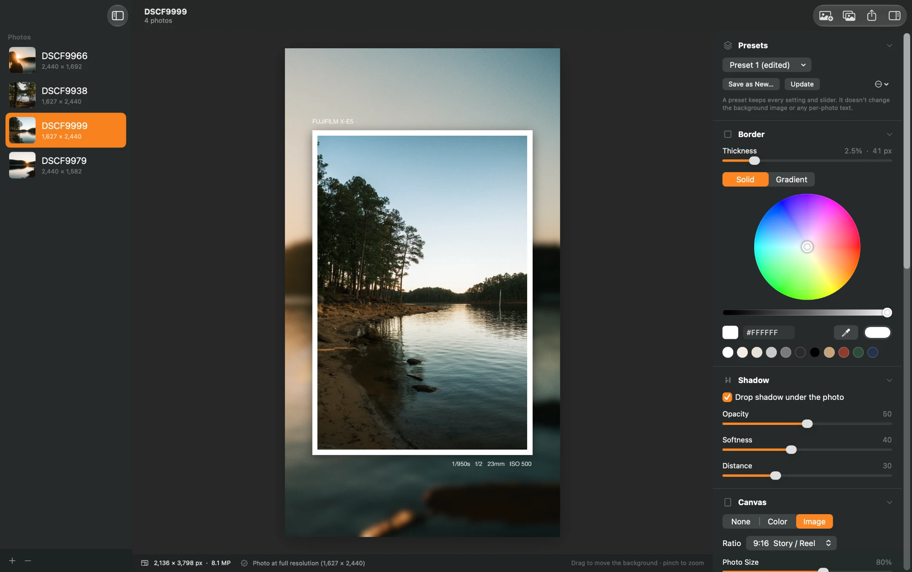

# Frame Studio

A small macOS app for framing photos: border, blurred background image, drop shadow and camera settings text,
exported without touching the photo's resolution.



## Run

Open `Frame Studio.app` (drag it to Applications if you like). You can also drop images onto its Dock icon
or use Finder → Open With → Frame Studio.

## Rebuild

```bash
./build.sh
```

Needs the Xcode Command Line Tools (Swift 5.9+). Produces `Frame Studio.app` next to the script.

## What it does

- **Photos:** add one or several (⌘O or drag in). All settings apply to every photo; Export All writes them in one go.
- **Border:** thickness (% of the photo's short side), solid color from a wheel / hex / eyedropper / system picker, or a two-color gradient.
- **Shadow:** opacity, softness, distance.
- **Canvas:** None (just photo + border), Color, or Image, plus a 9:16 / 4:5 / 1:1 / … ratio and a Photo Size slider.
- **Sliders:** double-click a slider (or its label) to reset it to 0, or to its default when 0 is out of range.
- **Background image:** blur, grain, grain size, brightness, zoom, move horizontally / vertically. You can also drag on the preview to move it and pinch to zoom.
- **Text:** two lines that sit above or below the photo, each with its own alignment and X/Y offsets, sharing any installed font and style, size, letter spacing and color.
  - *Camera settings:* shutter speed, aperture, focal length and ISO from the photo's EXIF.
  - *Second line:* camera model, film simulation, copyright, location, or your own text. Camera model, copyright and location come from the photo's metadata. Film simulation is read from Lightroom's Fujifilm camera profile (e.g. "Camera CLASSIC CHROME"), or picked from a dropdown for photos that don't record one.
  - Text from metadata can be edited per photo. The second line defaults to the spot opposite the camera settings; put both in the same spot to stack them as two lines.
- **Export:** JPEG / HEIC (quality slider), PNG / TIFF (lossless). Existing files are never overwritten.
- **Presets:** save every setting and slider (border, shadow, canvas, background adjustments, text, export options) under a name, switch between presets from the inspector or with ⌘1–⌘9, update, rename or delete them, and export/import them as files. A preset never changes the loaded background image or any per-photo text.

## Quality

The canvas is sized around the photo, so the photo is placed at 100% of its own pixels with no resampling.
Its color profile and bit depth (including 16-bit) are kept, and EXIF is copied when "Keep camera metadata" is on.
With PNG or TIFF, the photo's pixels in the output are bit-identical to the original. JPEG/HEIC re-encode the
whole image, so they are visually lossless at 100% but not bit-exact.

## Developer checks

The binary has a hidden CLI used for testing:

```bash
FrameStudio --cli render --photo in.jpg --bg bg.jpg --out out.png --format png --style '{"photoSize":0.8}'
FrameStudio --cli verify --photo in.jpg --out out.png
```

`verify` compares the photo region of an export against the source pixel by pixel.
